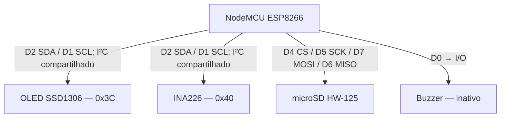
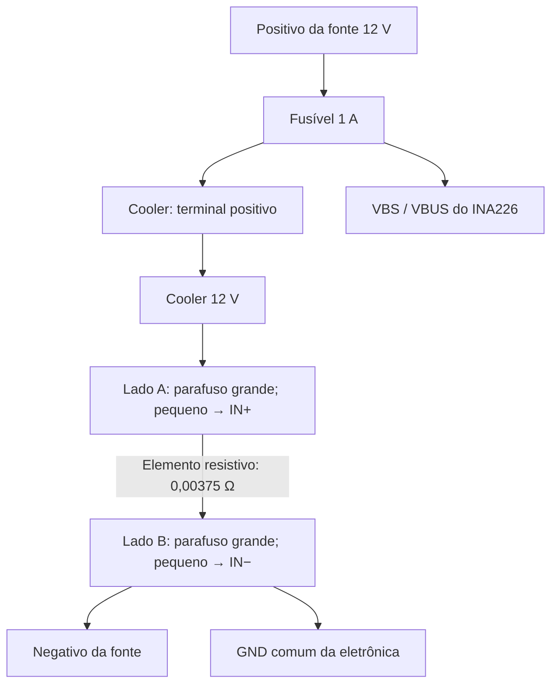

# Monitor de energia — NodeMCU / ESP8266

Documentação da montagem de bancada validada em 03/10/2026.

O projeto mede tensão, corrente e potência de um circuito de corrente contínua, apresenta as leituras em um OLED e grava o histórico em um cartão microSD. O Wi-Fi fornece sincronização opcional de data e hora. A medição, a gravação e a rotação dos arquivos funcionam sem conexão de rede.

As configurações são feitas diretamente no [firmware monitor_rotacao.ino](monitor_rotacao.ino). Botões, encoder e expansor de entradas estão fora da montagem atual.

## 1. Recursos implementados

- Leitura do INA226 por I²C, com shunt externo de 20 A / 75 mV.
- Cálculo de corrente e potência no NodeMCU.
- OLED com data, estado do SD, símbolo Wi-Fi e intensidade de sinal.
- Tensão, corrente e potência em fonte grande, com três casas decimais.
- Logo de bateria e “Monitor de Energia” durante aproximadamente 3 segundos na inicialização.
- Uma medição aproximadamente a cada segundo.
- CSV com até 10.000 medições, além de uma linha de cabeçalho.
- Retenção dos 100 arquivos de log mais recentes.
- Novo arquivo a cada reinicialização.
- Sincronização NTP opcional no fuso de São Paulo.
- Saída de diagnóstico na porta serial a 115200 baud.

O buzzer está conectado e foi testado separadamente. O firmware atual o mantém inativo; ainda não há alarmes sonoros, menus, controle da carga, interface web ou cálculo de energia acumulada em Wh.

## 2. Placas, módulos e materiais

| Componente | Modelo/característica da montagem | Função |
|---|---|---|
| Microcontrolador | NodeMCU LoLin com ESP8266 / ESP-12 | Leitura, processamento, tela, armazenamento e Wi-Fi |
| Medidor | Módulo WCMCU-226 com INA226 | Medição de tensão de barramento e queda no shunt |
| Shunt externo | FL-2, 20 A / 75 mV, classe marcada 0.5 | Elemento resistivo de medição de corrente |
| Tela | OLED SSD1306, 128 × 64, I²C, faixa amarela e azul | Apresentação das informações |
| Adaptador microSD | HW-125, AMS1117-3.3 e 74LVC125A | Interface SPI do cartão |
| Cartão | microSD, aproximadamente 16 GB, formatado e testado | Histórico em CSV |
| Buzzer | Módulo de três pinos VCC, I/O e GND, marcado “Low Level Trigger” | Recurso sonoro reservado |
| Fonte de bancada | Linksys LS120V10A, 12 V CC / 1 A, centro positivo | Alimentação do circuito sob medição |
| Carga de teste | Cooler MXT de 12 V, 90 × 90 × 25 mm | Consumo usado na validação |
| Proteção | Fusível de 1 A e porta-fusível | Proteção do circuito de teste |
| Alimentação da lógica | Cabo USB do NodeMCU | Alimentação do NodeMCU e módulos |
| Montagem | Protoboard, fios e conexões nos parafusos do shunt | Interligações de sinal e potência |

**Bateria disponível:** Moura 12MN300, 12 V, 30 Ah no regime C20; leitura informada de 12,9 V no multímetro. A validação descrita aqui foi feita com a fonte de 12 V e o cooler. A bateria não alimenta o NodeMCU diretamente e não faz parte do ensaio atual.

## 3. Visão geral das conexões de sinal



O diagrama representa os sinais. As alimentações e o GND devem ser ligados conforme as tabelas seguintes.

### Mapa de pinos do NodeMCU

| Pino da placa | GPIO | Uso atual |
|---|---:|---|
| D0 | 16 | I/O do buzzer |
| D1 | 5 | SCL do OLED e INA226 |
| D2 | 4 | SDA do OLED e INA226 |
| D3 | 0 | Sem uso no projeto |
| D4 | 2 | CS do microSD |
| D5 | 14 | SCK do microSD |
| D6 | 12 | MISO do microSD |
| D7 | 13 | MOSI do microSD |
| D8 | 15 | Sem uso no projeto |
| 3V / 3V3 | — | Alimentação de OLED, INA226 e buzzer |
| VU | — | 5 V USB, medidos na placa usada; alimentação do HW-125 |
| G / GND | — | Referência comum |
| A0, RX, TX | — | Sem conexões externas neste projeto |

D4 participa da seleção de modo de inicialização do ESP8266. O circuito conectado a CS não deve forçar esse pino a nível baixo durante o reset. As conexões desta montagem já permitiram inicialização e operação do SD.

### OLED SSD1306

| Pino do OLED | Conexão |
|---|---|
| GND | GND comum |
| VCC | 3V3 do NodeMCU |
| SCL | D1 |
| SDA | D2 |

Endereço usado: **0x3C**. Conferir os nomes impressos no módulo, pois a ordem dos pinos pode variar entre fabricantes.

### INA226 WCMCU-226

| Pino/ponto do módulo | Conexão |
|---|---|
| VCC | 3V3 do NodeMCU |
| GND | GND comum, referenciado ao lado B do shunt |
| SDA | D2 |
| SCL | D1 |
| ALE / ALERT | Sem conexão |
| VBS / VBUS | Positivo de 12 V depois do fusível |
| IN+ | Parafuso pequeno do lado A do shunt: lado da carga |
| IN− | Parafuso pequeno do lado B do shunt: lado do negativo da fonte |

Endereço usado: **0x40**.

**Modificação realizada:** o resistor R100 original, de 0,1 Ω, foi removido para usar somente o shunt externo de 0,00375 Ω. Os pads vazios não foram unidos com solda nem fio.

Com a placa desenergizada e o shunt externo desconectado, foi verificado:

- Ausência de continuidade entre os dois pads onde estava o R100.
- Continuidade de cada pad grande do módulo até seu respectivo IN+ ou IN−.

O shunt externo tem resistência muito baixa: seu teste de continuidade normalmente apita entre os lados. Isso não significa que esteja defeituoso. Não se deve colocar uma ponte entre os lados A e B, pois ela desviaria a corrente do elemento de medição.

### Adaptador microSD HW-125

| Pino do HW-125 | Conexão |
|---|---|
| GND | GND comum |
| VCC | VU do NodeMCU: 5 V USB nesta placa |
| MISO | D6 |
| MOSI | D7 |
| SCK | D5 |
| CS | D4 |

O módulo fotografado contém regulador de 3,3 V e buffer de sinais. A ligação de VCC a 5 V é específica deste adaptador; não corresponde a aplicar 5 V diretamente ao cartão ou aos GPIOs do ESP8266. O VU foi medido no NodeMCU utilizado e depende da alimentação USB. Conferir a placa antes de repetir essa ligação em outro modelo.

D5, D6 e D7 ficam exclusivos dos sinais SPI nesta montagem. Os antigos botões não devem ser reconectados nesses pinos.

### Buzzer

| Pino do módulo | Conexão |
|---|---|
| VCC | 3V3 do NodeMCU |
| GND | GND comum |
| I/O | D0 |

No teste realizado, um nível fixo produziu apenas um clique; um sinal alternado produziu som contínuo. O firmware atual define D0 em HIGH e mantém o buzzer inativo. A inscrição “Low Level Trigger” não basta, por si só, para determinar se o elemento sonoro é ativo ou passivo.

## 4. Esquemático do circuito medido — shunt no negativo

A montagem usa **medição no retorno negativo**, também chamada low-side. Os lados A e B são definidos pela conexão, e não pela posição esquerda/direita do shunt.



### Conexões de potência e de referência

| Origem | Destino | Tipo de conexão |
|---|---|---|
| Positivo da fonte | Entrada do fusível de 1 A | Potência |
| Saída do fusível | Positivo do cooler | Potência |
| Negativo do cooler | Parafuso grande do lado A do shunt | Potência |
| Parafuso grande do lado B | Negativo da fonte | Potência |
| Saída do fusível | VBS / VBUS do INA226 | Medição de tensão |
| Parafuso pequeno do lado A | IN+ do INA226 | Sense |
| Parafuso pequeno do lado B | IN− do INA226 | Sense |
| Lado B / negativo da fonte | GND do INA226 e NodeMCU | Referência comum |

Os parafusos grandes conduzem a corrente da carga. Os pequenos medem a queda de tensão no elemento resistivo. Cada parafuso pequeno pertence ao mesmo lado elétrico do parafuso grande correspondente.

Use um par de fios de sense torcidos entre o shunt e IN+/IN−, com contato firme. Eles não conduzem a corrente do cooler. O fio de GND liga a eletrônica ao nó B e também não deve servir de retorno de potência da carga.

**Todo o retorno do cooler deve passar pelo shunt.** Uma ligação direta do negativo do cooler ao negativo da fonte ou ao GND comum contornaria o shunt e produziria corrente próxima de zero na medição, mesmo com o cooler girando.

Os pads grandes do módulo INA226 não são usados para conduzir a corrente da carga nesta montagem. A corrente passa pelo shunt externo e pelos cabos ligados aos seus parafusos grandes.

### Alimentação da eletrônica

O NodeMCU permanece alimentado pela USB. OLED, INA226 e buzzer usam o 3V3 do NodeMCU; o adaptador HW-125 usa o VU de 5 V USB. Todos compartilham o GND.

A fonte de 12 V alimenta o cooler. Seu negativo é unido ao GND da eletrônica no lado B do shunt. **Não conectar 12 V ao VCC do INA226, ao 3V3, ao VU, ao OLED ou aos GPIOs.** VBS é a entrada de medição de tensão, distinta de VCC.

Na montagem final com bateria, manter proteção próxima ao terminal positivo, cabos compatíveis com a corrente e isolamento dos terminais. O fusível de 1 A e a fonte de 1 A descrevem o ensaio com cooler; não definem uma instalação para carga de 20 A. O caminho de potência não passa pela protoboard.

## 5. Como as medições são calculadas

O firmware lê diretamente os registros de tensão do INA226:

| Registro | Leitura | Conversão usada |
|---|---|---|
| 0x01 | Tensão diferencial do shunt, com sinal | valor de 16 bits com sinal × 2,5 µV |
| 0x02 | Tensão de barramento | valor sem sinal × 1,25 mV |

Para o shunt de 20 A / 75 mV:

```text
R_shunt = 0,075 V / 20 A = 0,00375 Ω
I = V_shunt / R_shunt
P = V_barramento × I
```

Exemplo: 0,750 mV no shunt correspondem a aproximadamente 0,200 A. Com 11,980 V no barramento, a potência calculada é 2,396 W.

O cálculo é feito no software. O firmware não usa os registros internos de corrente/potência nem escreve o registro de calibração do INA226. Ele também não configura explicitamente média ou tempo de conversão do sensor.

VBUS mede o positivo depois do fusível em relação ao GND do lado B. Portanto, a potência representa a potência no ponto monitorado; não desconta a pequena queda no shunt e nos cabos para obter a potência exata nos terminais do cooler.

A marcação do shunt é uma referência nominal. As três casas decimais na tela não significam que a montagem tenha essa exatidão. Uma calibração de precisão deve comparar as leituras com instrumentos de referência.

## 6. Ambiente e dependências

Ambiente utilizado: Ubuntu, Arduino IDE 2.3.10 e suporte de placas ESP8266.

1. Instalar o pacote de placas **esp8266 by ESP8266 Community** pelo Gerenciador de Placas. Quando necessário, usar a URL de índice indicada na documentação oficial: `https://arduino.esp8266.com/stable/package_esp8266com_index.json`.
2. Selecionar **NodeMCU 1.0 (ESP-12E Module)** e a porta USB correspondente.
3. Instalar **Adafruit GFX Library** e **Adafruit SSD1306**, incluindo as dependências solicitadas pela IDE.
4. Usar `Wire`, `SPI`, `SD`, `ESP8266WiFi`, `time.h`, `TZ.h` e `sntp.h` fornecidos pelo ambiente do core ESP8266 compatível com o sketch.
5. Abrir `monitor_rotacao.ino` dentro da pasta `monitor_rotacao`.
6. Ajustar as credenciais, verificar/compilar e enviar à placa.
7. Abrir o Monitor Serial em **115200 baud**.

Não é necessária uma biblioteca específica do INA226. SdFat foi usado no procedimento separado de formatação; não é dependência do firmware atual, que usa `SD.h`.

Não foi registrada a versão exata do core ESP8266 nem das bibliotecas Adafruit usadas no ensaio. Registrar essas versões ao consolidar uma versão reproduzível do projeto.

## 7. Configurações no código

| Item | Valor atual | Onde alterar |
|---|---|---|
| Rede Wi-Fi | `Cronin 2G` | `SSID` |
| Senha Wi-Fi | Placeholder `SUA_SENHA` | `SENHA` |
| Intervalo entre medições | 1000 ms | `INTERVALO_MS` |
| Medições por arquivo | 10.000 | `MAX_LINHAS_ARQUIVO` |
| Arquivos retidos | 100 | `MAX_ARQUIVOS` |
| Resistência do shunt | 0,00375 Ω | `RESISTENCIA_SHUNT` |
| Endereço INA226 | 0x40 | `INA226` |
| Endereço OLED | 0x3C | Argumento de `tela.begin()` |
| Fuso | São Paulo | `TZ_America_Sao_Paulo` em `configTime()` |
| Servidores NTP | `pool.ntp.org`, `time.cloudflare.com` | `configTime()` |
| Tempo do logo | 3000 ms | `delay(3000)` em `mostrarLogo()` |

Espaços no SSID são permitidos. A rede usada foi ajustada para segurança em modo misto e o NodeMCU conectou. O ESP8266 usa Wi-Fi de 2,4 GHz; não se conecta a uma rede exclusivamente de 5 GHz.

A conexão é iniciada sem bloquear a medição à espera da rede. Se não houver rede, o programa segue medindo e gravando. Não compartilhar o sketch com uma senha real inserida sem antes removê-la.

## 8. Tela OLED

| Região | Informação |
|---|---|
| Cabeçalho esquerdo | `dd/mm`; antes da sincronização, `--/--` |
| Cabeçalho central | `SD:OK` ou `SD:ERR` |
| Cabeçalho direito | Símbolo Wi-Fi e quatro barras quando conectado |
| Wi-Fi desconectado | Corte diagonal sobre o próprio símbolo, sem barras |
| Primeira linha grande | `V:` — tensão em volts |
| Segunda linha grande | `A:` — corrente em amperes |
| Terceira linha grande | `W:` — potência em watts |

As medições usam margens laterais e começam abaixo da faixa amarela. Valores excepcionalmente longos usam fonte menor para evitar cortes. Se a leitura do INA226 falhar, as três linhas mostram `---`.

A intensidade Wi-Fi é uma escala visual aproximada baseada em RSSI:

| RSSI | Barras |
|---|---:|
| ≥ −55 dBm | 4 |
| ≥ −67 e < −55 dBm | 3 |
| ≥ −75 e < −67 dBm | 2 |
| < −75 dBm, ainda conectado | 1 |

Conexão Wi-Fi não comprova acesso à Internet ou ao NTP. O ícone indica associação à rede, não conectividade externa.

## 9. CSV, rotação e retenção

Os arquivos são criados na raiz do cartão:

```text
L000000.CSV
L000001.CSV
L000002.CSV
```

O cabeçalho é:

```csv
data_hora_local,tempo_ms,tensao_V,shunt_mV,corrente_A,potencia_W
```

Exemplos ilustrativos de linhas:

```csv
SEM_HORA,4500,11.980,0.750,0.200000,2.396000
2026-10-03T16:05:00-0300,5500,11.980,0.750,0.200000,2.396000
```

Separador: vírgula. Separador decimal: ponto. `tempo_ms` é o tempo desde a inicialização do NodeMCU, em milissegundos; reinicia após reset e sofre rollover aproximadamente a cada 49,7 dias.

### Regras de rotação

1. Cada inicialização cria um CSV novo, com o próximo número disponível após o maior existente.
2. O cabeçalho não entra na contagem de medições.
3. Até 10.000 linhas de medições são gravadas no arquivo atual.
4. A medição 10.001 inicia o próximo arquivo.
5. Antes de criar um novo arquivo, se já houver 100 logs, o de menor número é removido.
6. Se houver mais de 100 logs reconhecidos, os mais antigos são removidos até existir espaço dentro do limite de quantidade.
7. A ordem de retenção usa o número no nome, independentemente de NTP e das datas do sistema de arquivos.

Somente arquivos com nome `L` + seis dígitos + `.CSV`, na raiz, pertencem à retenção. Não usar esse padrão para outros documentos. Arquivos antigos como `M0000.CSV`, `teste.txt` e outros conteúdos são preservados e continuam ocupando espaço.

A contagem aumenta somente depois de uma escrita completa. O arquivo é aberto e fechado em cada medição. Isso reduz a janela de dados em aberto, mas não garante integridade em uma queda abrupta de alimentação durante escrita ou atualização do sistema de arquivos.

### Capacidade e período de histórico

Com uma medição por segundo, 10.000 medições equivalem a aproximadamente **2 h 46 min 40 s**. Cem arquivos completos representam até **1.000.000 de medições**, aproximadamente **11 dias 13 h 46 min 40 s**. Reinicializações e falhas de leitura podem reduzir ou alterar esse período.

O buffer limita uma linha gravável a 159 bytes. Assim, um conjunto novo de 100 arquivos completos fica abaixo de aproximadamente **160 MB de conteúdo CSV**, além dos cabeçalhos e da ocupação do sistema de arquivos. Arquivos maiores criados por versões anteriores não são reduzidos; serão removidos gradualmente pela retenção.

Não há consulta de espaço livre nem limpeza de conteúdos alheios. A retenção limita os logs deste firmware, mas não impede que outros arquivos encham o cartão. O limite de numeração é `L999999.CSV`; ao atingir o próximo número, o firmware interrompe a gravação em vez de sobrescrever arquivos.

## 10. Funcionamento sem Wi-Fi e NTP

Sem hora válida, `data_hora_local` recebe `SEM_HORA` e a tela mostra `--/--`. Ao sincronizar, novas linhas recebem data/hora local com o deslocamento `-0300`. As linhas anteriores não são reescritas.

Após sincronização, o relógio do sistema continua avançando mesmo se o Wi-Fi cair, sujeito à deriva. Após reiniciar sem rede, a hora volta a depender de uma nova sincronização: não há RTC com bateria instalado.

A rotação e a retenção nunca dependem da data/hora. A data mostrada na tela e escrita no CSV também não configura automaticamente a data de modificação dos arquivos no cartão; o sketch não instala callback de timestamp FAT.

## 11. Validação e comportamento de falhas

Resultados observados na bancada:

- OLED exibindo corretamente as três medições; último ajuste de margens aprovado.
- INA226 respondendo em 0x40, OLED em 0x3C.
- Leitura/escrita do cartão funcionando e CSV acessível no notebook.
- Wi-Fi conectado após ajuste de segurança do ponto de acesso.
- NTP sincronizado no fuso de São Paulo.
- Cooler com tensão próxima de 11,98 V, corrente normalmente próxima de 0,20 A e potência próxima de 2,4 W.
- Buzzer testado separadamente com sinal alternado.

A lógica de limite de linhas e retenção foi testada em simulação no computador, incluindo a transição da medição 10.000 para a 10.001 e a manutenção de 100 logs. Isso não equivale a um ensaio prolongado no cartão físico.

| Situação | Comportamento atual |
|---|---|
| Falha do OLED | Diagnóstico serial; medição e SD continuam |
| Falha de leitura INA226 | Não grava a amostra; serial informa erro e tela mostra `---` |
| Falha de inicialização do SD | Gravação desativada; medição e tela continuam |
| Falha de abrir, escrever, criar ou remover log | Gravação interrompida; `SD:ERR` |
| Wi-Fi indisponível | Medição, tela e SD continuam |
| NTP indisponível | Usa `SEM_HORA` até obter hora válida |

Depois de corrigir uma falha de SD, reiniciar o NodeMCU: a versão atual não tenta reinicializar o cartão automaticamente. `SD:OK` representa o resultado das operações do firmware, não uma verificação independente do conteúdo persistido.

## 12. Diagnóstico de bancada

| Sintoma | Verificação |
|---|---|
| Tensão sempre zero | VBS no positivo após fusível; negativo da fonte unido ao GND no lado B |
| Cooler gira, corrente próxima de zero | Verificar desvio do shunt e contatos de IN+/IN− nos parafusos pequenos |
| Corrente negativa com a carga consumindo | Conferir se IN+ está no lado A e IN− no lado B |
| Shunt muito instável | Revisar contatos, fios de sense torcidos e referência de GND |
| Tensão cai lentamente depois de desligar a fonte | Pode haver descarga de capacitores e tensão residual; conferir com multímetro |
| Valores pequenos sem carga | Ruído/offset: o firmware não aplica banda morta nem correção de zero |
| OLED apagado | Conferir 3V3, GND, SDA D2, SCL D1 e endereço 0x3C |
| `SD:ERR` | Conferir VU, GND, SPI, cartão formatado, espaço e mensagens seriais |
| `SEM_HORA` com Wi-Fi conectado | Conferir Internet, DNS e acesso a NTP; Wi-Fi conectado não garante sincronização |
| Caracteres estranhos no início da serial | Mensagem de boot pode usar baud diferente; sketch opera em 115200 |

Revisar conexões de potência com fonte/bateria desconectada. Não medir resistência ou continuidade em um circuito energizado.

## 13. Componentes descartados nesta versão

- Encoder rotativo Keyes: retirado após os testes de giro não fornecerem sequência útil.
- Três botões momentâneos: testados, mas retirados da montagem atual.
- PCF8574: proposto para futura expansão, não instalado.
- LEDs externos: não usados.

Nenhum desses componentes participa dos esquemas ou da configuração atual. Alterações de parâmetros são feitas no código e exigem novo upload.

## 14. Referências oficiais

- [INA226 — datasheet Texas Instruments](https://www.ti.com/lit/ds/symlink/ina226.pdf): entradas VBUS/IN+/IN− e fatores dos registros de tensão.
- [ESP8266 Arduino Core — bibliotecas e interfaces](https://arduino-esp8266.readthedocs.io/en/latest/libraries.html): I²C, SPI e bibliotecas do core.
- [ESP8266 Arduino Core — instalação](https://arduino-esp8266.readthedocs.io/en/latest/installing.html).
- [ESP8266 Arduino Core — Wi-Fi Station](https://arduino-esp8266.readthedocs.io/en/latest/esp8266wifi/station-class.html): conexão e RSSI.
- [Exemplo oficial NTP/TZ/DST](https://github.com/esp8266/Arduino/blob/master/libraries/esp8266/examples/NTP-TZ-DST/NTP-TZ-DST.ino).
- [Adafruit SSD1306](https://github.com/adafruit/Adafruit_SSD1306) e [Adafruit GFX](https://github.com/adafruit/Adafruit-GFX-Library).

As conexões de VU, o modelo dos módulos, a remoção do R100 e os resultados de bancada são específicos dos componentes e testes deste projeto. Conferir a serigrafia e o circuito ao substituir qualquer placa.