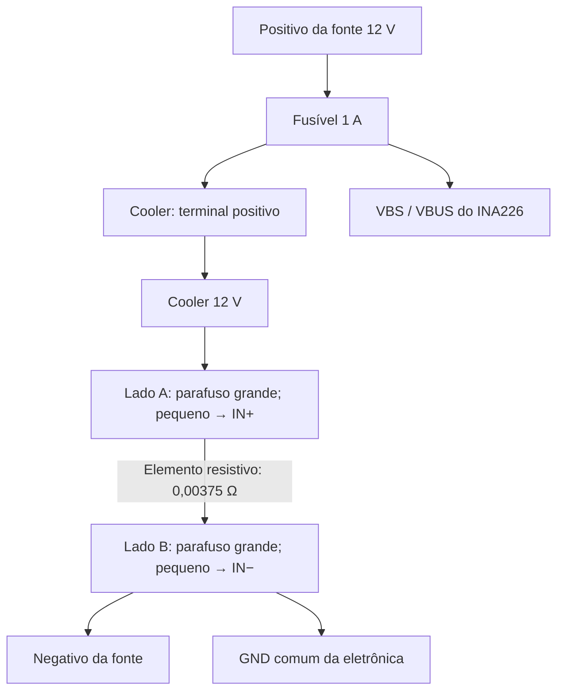

# Monitor de energia — NodeMCU / ESP8266

Documentação atualizada em **12/10/2026**, conforme o firmware `monitor_menu.ino` e os testes de bancada relatados. A versão com brilho por LED, timeout e navegação/rotação de telas foi compilada e testada em software e o layout foi renderizado com Adafruit GFX; sua validação física ainda deve ser concluída.

O projeto mede tensão, corrente e potência de um circuito de corrente contínua, apresenta as leituras em um OLED e grava o histórico em um cartão microSD. O Wi-Fi fornece sincronização opcional de data e hora. A medição, a gravação e a rotação dos arquivos funcionam sem conexão de rede.

Firmware atual: [monitor_menu.ino](monitor_menu.ino). Os limites e ajustes sonoros são definidos por três botões ligados ao MCP23017 e persistidos na memória interna LittleFS. Credenciais Wi-Fi, shunt, retenção e opções de hardware permanecem no código.

## 1. Recursos implementados

- Leitura do INA226 por I²C, com shunt externo de 20 A / 75 mV.
- Cálculo de corrente e potência no NodeMCU.
- OLED com data, estado do SD e barras de intensidade do Wi-Fi, sem símbolo redundante.
- Telas de resumo, tensão/bateria, corrente, potência e alerta; ícones à esquerda e valores à direita.
- Rotação opcional de 5 a 30 segundos e prioridade de alertas em ciclos de 30 segundos.
- Tensão, corrente e potência em fonte grande, com três casas decimais.
- Logo de bateria e “Monitor de Energia” durante aproximadamente 3 segundos na inicialização.
- Uma medição aproximadamente a cada segundo.
- CSV com até 10.000 medições, além de uma linha de cabeçalho.
- Retenção dos 100 arquivos de log mais recentes.
- Novo arquivo a cada reinicialização.
- Sincronização NTP opcional no fuso de São Paulo.
- Saída de diagnóstico na porta serial a 115200 baud.

- Menu com Anterior, Confirmar e Próximo, via MCP23017 em 0x20.
- Configurações persistentes no LittleFS, independentes do cartão SD e do Wi-Fi.
- Quatro LEDs: vermelho, amarelo, verde e azul, com estados simultâneos.
- Alarmes de tensão baixa/crítica/alta, sobrecorrente, falha do INA226 e falha do SD.
- Registro de transições de alarme e retorno à normalidade no SD.
- Indicador de alertas ainda não reconhecidos no OLED e no LED amarelo.
- Reconhecimento de alertas (ACK) pelo menu, registrado no SD e recuperado após reiniciar.
- Sequências sonoras temporizadas no loop, sem bloquear pelos períodos dos beeps.

**Não há desligamento automático da carga**, interface web ou cálculo de energia acumulada em Wh. O alarme é um aviso; não substitui fusível ou proteção elétrica. Operações de cartão e o logo de inicialização ainda podem ocupar tempo no loop.

## 2. Placas, módulos e materiais

| Componente | Modelo/característica da montagem | Função |
|---|---|---|
| Microcontrolador | NodeMCU LoLin com ESP8266 / ESP-12 | Leitura, processamento, tela, armazenamento e Wi-Fi |
| Medidor | Módulo WCMCU-226 com INA226 | Medição de tensão de barramento e queda no shunt |
| Shunt externo | FL-2, 20 A / 75 mV, classe marcada 0.5 | Elemento resistivo de medição de corrente |
| Tela | OLED SSD1306, 128 × 64, I²C, faixa amarela e azul | Apresentação das informações |
| Adaptador microSD | HW-125, AMS1117-3.3 e 74LVC125A | Interface SPI do cartão |
| Cartão | microSD, aproximadamente 16 GB, formatado e testado | Histórico em CSV |
| Expansor I²C | MCP23017, alimentado em 3,3 V, endereço 0x20 | Três botões e quatro LEDs |
| Botões | Três push-buttons momentâneos, sem trava | Anterior, Confirmar e Próximo |
| LEDs | Vermelho, amarelo, verde e azul | Indicação dos estados do firmware |
| Resistores dos LEDs | Um por LED, nominal 1 kΩ; medido próximo de 960 Ω | Limitação da corrente |
| Resistor RESET | Próximo de 10 kΩ; disponível de 9,7 kΩ | Pull-up do RESET do MCP23017 |
| Buzzer atual | Módulo de três pinos, marcado High Level | Alarmes; configurado como ativo, HIGH liga / LOW desliga |
| Buzzer futuro | Módulo passivo planejado, ainda não instalado | Variação de frequência e intensidade por PWM |
| Fonte de bancada | Linksys LS120V10A, 12 V CC / 1 A, centro positivo | Alimentação do circuito sob medição |
| Carga de teste | Cooler MXT de 12 V, 90 × 90 × 25 mm | Consumo usado na validação |
| Proteção | Fusível de 1 A e porta-fusível | Proteção do circuito de teste |
| Alimentação da lógica | Cabo USB do NodeMCU | Alimentação do NodeMCU e módulos |
| Montagem | Protoboard, fios e conexões nos parafusos do shunt | Interligações de sinal e potência |

**Bateria disponível:** Moura 12MN300, 12 V, 30 Ah no regime C20; leitura informada de 12,9 V no multímetro. A validação descrita aqui foi feita com a fonte de 12 V e o cooler. A bateria não alimenta o NodeMCU diretamente e não faz parte do ensaio atual.

## 3. Visão geral das conexões de sinal

O OLED, INA226 e MCP23017 compartilham SDA e SCL. O microSD usa SPI e o buzzer tem sinal dedicado em D0. O MCP23017 evita ocupar os pinos SPI com os botões e LEDs.

| Interface | NodeMCU | Dispositivos |
|---|---|---|
| I²C — SDA | D2 / GPIO4 | OLED, INA226 e MCP23017 |
| I²C — SCL | D1 / GPIO5 | OLED, INA226 e MCP23017 |
| SPI | D4 CS, D5 SCK, D6 MISO, D7 MOSI | microSD |
| Sinal sonoro | D0 / GPIO16 | I/O do buzzer |
| Entradas/saídas expandidas | GPA0–GPA2; GPB0–GPB3 | Botões; LEDs |

O diagrama representa os sinais. As alimentações e o GND devem ser ligados conforme as tabelas seguintes.

### Mapa de pinos do NodeMCU

| Pino da placa | GPIO | Uso atual |
|---|---:|---|
| D0 | 16 | I/O do buzzer |
| D1 | 5 | SCL do OLED, INA226 e MCP23017 |
| D2 | 4 | SDA do OLED, INA226 e MCP23017 |
| D3 | 0 | Sem uso no projeto |
| D4 | 2 | CS do microSD |
| D5 | 14 | SCK do microSD |
| D6 | 12 | MISO do microSD |
| D7 | 13 | MOSI do microSD |
| D8 | 15 | Sem uso no projeto |
| 3V / 3V3 | — | Alimentação de OLED, INA226 e MCP23017 |
| VU | — | 5 V USB, medidos na placa usada; alimentação do HW-125 |
| G / GND | — | Referência comum |
| A0, RX, TX | — | Sem conexões externas neste projeto |

D4 participa da seleção de modo de inicialização do ESP8266. O circuito conectado a CS não deve forçar esse pino a nível baixo durante o reset. As conexões desta montagem já permitiram inicialização e operação do SD.

### OLED SSD1306

| Pino do OLED | Conexão |
|---|---|
| GND | GND comum |
| VCC | 3V3 do NodeMCU |
| SCL | D1 |
| SDA | D2 |

Endereço usado: **0x3C**. Conferir os nomes impressos no módulo, pois a ordem dos pinos pode variar entre fabricantes.

### INA226 WCMCU-226

| Pino/ponto do módulo | Conexão |
|---|---|
| VCC | 3V3 do NodeMCU |
| GND | GND comum, referenciado ao lado B do shunt |
| SDA | D2 |
| SCL | D1 |
| ALE / ALERT | Sem conexão |
| VBS / VBUS | Positivo de 12 V depois do fusível |
| IN+ | Parafuso pequeno do lado A do shunt: lado da carga |
| IN− | Parafuso pequeno do lado B do shunt: lado do negativo da fonte |

Endereço usado: **0x40**.

**Modificação realizada:** o resistor R100 original, de 0,1 Ω, foi removido para usar somente o shunt externo de 0,00375 Ω. Os pads vazios não foram unidos com solda nem fio.

Com a placa desenergizada e o shunt externo desconectado, foi verificado:

- Ausência de continuidade entre os dois pads onde estava o R100.
- Continuidade de cada pad grande do módulo até seu respectivo IN+ ou IN−.

O shunt externo tem resistência muito baixa: seu teste de continuidade normalmente apita entre os lados. Isso não significa que esteja defeituoso. Não se deve colocar uma ponte entre os lados A e B, pois ela desviaria a corrente do elemento de medição.

### Adaptador microSD HW-125

| Pino do HW-125 | Conexão |
|---|---|
| GND | GND comum |
| VCC | VU do NodeMCU: 5 V USB nesta placa |
| MISO | D6 |
| MOSI | D7 |
| SCK | D5 |
| CS | D4 |

O módulo fotografado contém regulador de 3,3 V e buffer de sinais. A ligação de VCC a 5 V é específica deste adaptador; não corresponde a aplicar 5 V diretamente ao cartão ou aos GPIOs do ESP8266. O VU foi medido no NodeMCU utilizado e depende da alimentação USB. Conferir a placa antes de repetir essa ligação em outro modelo.

D5, D6 e D7 ficam exclusivos dos sinais SPI nesta montagem. Os botões atuais ficam no MCP23017; não conectá-los nesses pinos SPI.

### MCP23017 — alimentação e I²C

| Pino/identificação da placa | Conexão |
|---|---|
| VCC | 3V3 do NodeMCU |
| GND | GND comum |
| SDA / SI | D2 |
| SCL / SCK | D1 |
| RESET | Resistor de 9,7 kΩ ou 10 kΩ até 3V3; manter em nível alto |
| A0, A1 e A2 de endereço, no cabeçalho de controle | GND: endereço 0x20 |
| NC / SO e NC / CS | Sem conexão no uso I²C com MCP23017 |
| ITA / ITB | Sem conexão; o firmware consulta os botões por polling |

Os **A0–A2 de endereço** são diferentes das portas **GPA0–GPA2** dos botões. A placa tem inscrições compartilhadas com a versão SPI MCP23S17; neste projeto o chip instalado e testado é MCP23017.

Na foto da face com as inscrições `B0/A0` até `B7/A7`, na orientação em que `VCC/GND` fica no topo, a coluna esquerda corresponde a B e a direita a A. Conferir a serigrafia e a orientação antes de soldar.

### Botões

| Função | Porta MCP23017 | Ligação |
|---|---|---|
| Anterior | GPA0 / A0 da porta A | Botão entre GPA0 e GND |
| Confirmar | GPA1 / A1 da porta A | Botão entre GPA1 e GND |
| Próximo | GPA2 / A2 da porta A | Botão entre GPA2 e GND |

O firmware habilita os pull-ups internos: solto = HIGH, pressionado = LOW. Há debounce de 35 ms. Em botões com quatro terminais, usar contatos que sejam unidos somente ao pressionar, identificados com continuidade sem alimentação.

### LEDs — conexões

| Cor | Porta MCP23017 | Caminho da ligação |
|---|---|---|
| Vermelho | GPB0 / B0 | GPB0 → resistor 1 kΩ → ânodo do LED; cátodo → GND |
| Amarelo | GPB1 / B1 | GPB1 → resistor 1 kΩ → ânodo; cátodo → GND |
| Verde | GPB2 / B2 | GPB2 → resistor 1 kΩ → ânodo; cátodo → GND |
| Azul | GPB3 / B3 | GPB3 → resistor 1 kΩ → ânodo; cátodo → GND |

Cada LED tem seu próprio resistor. HIGH acende; LOW apaga. O resistor não tem polaridade. Ânodo é o terminal positivo do LED; cátodo é o negativo. Se houver dúvida, identificar pelo teste de diodo do multímetro.

### Buzzer atual — High Level

| Pino do módulo | Conexão |
|---|---|
| VCC | Alimentação nominal especificada para o módulo atual; confirmar se 3,3 V ou 5 V antes de ligar |
| GND | GND comum |
| I/O | D0 |
| Pull-down proposto | Resistor de 9,7 kΩ ou 10 kΩ entre I/O e GND, em paralelo ao sinal |

A tensão de alimentação do novo módulo não foi documentada de forma suficiente para tratá-la como igual à do módulo antigo. Não aplicar 5 V diretamente a um GPIO do NodeMCU.

O código atual usa `BUZZER_PASSIVO = false`: **HIGH liga e LOW desliga**. No modo ativo, frequência e volume dependem do elemento sonoro; o firmware controla duração, quantidade e intervalo dos beeps. A inscrição High Level indica a polaridade de acionamento, não comprova sozinha que o buzzer seja ativo.

Durante o upload, o sketch não controla a saída. Foi proposto testar o resistor pull-down para evitar acionamento indesejado; sua instalação e eficácia ainda não foram confirmadas. Caso continue apitando, verificar a tensão e o circuito da entrada I/O.

O módulo anterior Low Level foi descartado após dano nos pads. A futura substituição por um módulo passivo exige confirmar a polaridade e adaptar o acionamento antes de habilitar PWM; não basta trocar apenas a placa.

## 4. Esquemático do circuito medido — shunt no negativo

A montagem usa **medição no retorno negativo**, também chamada low-side. Os lados A e B são definidos pela conexão, e não pela posição esquerda/direita do shunt.



### Conexões de potência e de referência

| Origem | Destino | Tipo de conexão |
|---|---|---|
| Positivo da fonte | Entrada do fusível de 1 A | Potência |
| Saída do fusível | Positivo do cooler | Potência |
| Negativo do cooler | Parafuso grande do lado A do shunt | Potência |
| Parafuso grande do lado B | Negativo da fonte | Potência |
| Saída do fusível | VBS / VBUS do INA226 | Medição de tensão |
| Parafuso pequeno do lado A | IN+ do INA226 | Sense |
| Parafuso pequeno do lado B | IN− do INA226 | Sense |
| Lado B / negativo da fonte | GND do INA226 e NodeMCU | Referência comum |

Os parafusos grandes conduzem a corrente da carga. Os pequenos medem a queda de tensão no elemento resistivo. Cada parafuso pequeno pertence ao mesmo lado elétrico do parafuso grande correspondente.

Use um par de fios de sense torcidos entre o shunt e IN+/IN−, com contato firme. Eles não conduzem a corrente do cooler. O fio de GND liga a eletrônica ao nó B e também não deve servir de retorno de potência da carga.

**Todo o retorno do cooler deve passar pelo shunt.** Uma ligação direta do negativo do cooler ao negativo da fonte ou ao GND comum contornaria o shunt e produziria corrente próxima de zero na medição, mesmo com o cooler girando.

Os pads grandes do módulo INA226 não são usados para conduzir a corrente da carga nesta montagem. A corrente passa pelo shunt externo e pelos cabos ligados aos seus parafusos grandes.

### Alimentação da eletrônica

O NodeMCU permanece alimentado pela USB. OLED, INA226 e MCP23017 usam o 3V3 do NodeMCU; o adaptador HW-125 usa o VU de 5 V USB. O buzzer usa a alimentação nominal do módulo instalado. Todos compartilham o GND.

A fonte de 12 V alimenta o cooler. Seu negativo é unido ao GND da eletrônica no lado B do shunt. **Não conectar 12 V ao VCC do INA226, ao 3V3, ao VU, ao OLED ou aos GPIOs.** VBS é a entrada de medição de tensão, distinta de VCC.

Na montagem final com bateria, manter proteção próxima ao terminal positivo, cabos compatíveis com a corrente e isolamento dos terminais. O fusível de 1 A e a fonte de 1 A descrevem o ensaio com cooler; não definem uma instalação para carga de 20 A. O caminho de potência não passa pela protoboard.

## 5. Como as medições são calculadas

O firmware lê diretamente os registros de tensão do INA226:

| Registro | Leitura | Conversão usada |
|---|---|---|
| 0x01 | Tensão diferencial do shunt, com sinal | valor de 16 bits com sinal × 2,5 µV |
| 0x02 | Tensão de barramento | valor sem sinal × 1,25 mV |

Para o shunt de 20 A / 75 mV:

```text
R_shunt = 0,075 V / 20 A = 0,00375 Ω
I = V_shunt / R_shunt
P = V_barramento × I
```

Exemplo: 0,750 mV no shunt correspondem a aproximadamente 0,200 A. Com 11,980 V no barramento, a potência calculada é 2,396 W.

O cálculo é feito no software. O firmware não usa os registros internos de corrente/potência nem escreve o registro de calibração do INA226. Ele também não configura explicitamente média ou tempo de conversão do sensor.

VBUS mede o positivo depois do fusível em relação ao GND do lado B. Portanto, a potência representa a potência no ponto monitorado; não desconta a pequena queda no shunt e nos cabos para obter a potência exata nos terminais do cooler.

A marcação do shunt é uma referência nominal. As três casas decimais na tela não significam que a montagem tenha essa exatidão. Uma calibração de precisão deve comparar as leituras com instrumentos de referência.

## 6. Ambiente e dependências

Ambiente utilizado: Ubuntu, Arduino IDE 2.3.10 e suporte de placas ESP8266.

1. Instalar o pacote de placas **esp8266 by ESP8266 Community** pelo Gerenciador de Placas. Quando necessário, usar a URL de índice indicada na documentação oficial: `https://arduino.esp8266.com/stable/package_esp8266com_index.json`.
2. Selecionar **NodeMCU 1.0 (ESP-12E Module)** e a porta USB correspondente.
3. Instalar **Adafruit GFX Library** e **Adafruit SSD1306**, incluindo as dependências solicitadas pela IDE.
4. Usar `Wire`, `SPI`, `SD`, `LittleFS`, `ESP8266WiFi`, `time.h`, `TZ.h` e `sntp.h` fornecidos pelo ambiente do core ESP8266 compatível com o sketch.
5. Abrir `monitor_menu.ino` dentro da pasta `monitor_menu`. Selecionar Flash Size com espaço para filesystem, por exemplo **4MB (FS:1MB OTA:~1019KB)**, mantendo o mesmo layout usado no teste LittleFS.
6. Ajustar as credenciais, verificar/compilar e enviar à placa.
7. Abrir o Monitor Serial em **115200 baud**.

Não são necessárias bibliotecas específicas do INA226 ou MCP23017; seus registradores são acessados diretamente por `Wire`. SdFat foi usado no procedimento separado de formatação; não é dependência do firmware atual, que usa `SD.h`.

A última versão foi compilada para `esp8266:esp8266:nodemcuv2:eesz=4M1M`, com core ESP8266 **3.1.2**, Arduino CLI **1.3.1**, Adafruit GFX **1.12.6**, Adafruit SSD1306 **2.5.17** e Adafruit BusIO **1.17.4**. Isso valida a compilação; não substitui ensaio físico. As versões instaladas no notebook podem ser diferentes.

## 7. Configurações no código

| Item | Valor atual | Onde alterar |
|---|---|---|
| Rede Wi-Fi | `Cronin 2G` | `SSID` |
| Senha Wi-Fi | Placeholder `SENHA` | `SENHA` |
| Intervalo entre medições | 1000 ms | `INTERVALO_MS` |
| Medições por arquivo | 10.000 | `MAX_LINHAS_ARQUIVO` |
| Arquivos retidos | 100 | `MAX_ARQUIVOS` |
| Resistência do shunt | 0,00375 Ω | `RESISTENCIA_SHUNT` |
| Endereço INA226 | 0x40 | `INA226` |
| Endereço OLED | 0x3C | Argumento de `tela.begin()` |
| Fuso | São Paulo | `TZ_America_Sao_Paulo` em `configTime()` |
| Servidores NTP | `pool.ntp.org`, `time.cloudflare.com` | `configTime()` |
| Tempo do logo | 3000 ms, além do beep inicial | Espera cooperativa em `mostrarLogo()`, atendendo ao PWM dos LEDs |
| Tipo de buzzer | Ativo: `false` | `BUZZER_PASSIVO` |
| Polaridade do buzzer | HIGH ligado, LOW desligado | `NIVEL_BUZZER_LIGADO`, `NIVEL_BUZZER_DESLIGADO` e implementação do acionamento |
| Repetição do alarme | 15 segundos entre inícios de sequências | `REPETICAO_ALARME_MS` |
| Confirmação de condição | 3 segundos | `CONFIRMACAO_CONDICAO_MS` |
| Histerese de tensão | 0,20 V | `HISTERESE_TENSAO_V` |
| Histerese de corrente | 0,05 A | `HISTERESE_CORRENTE_A` |

Espaços no SSID são permitidos. A rede usada foi ajustada para segurança em modo misto e o NodeMCU conectou. O ESP8266 usa Wi-Fi de 2,4 GHz; não se conecta a uma rede exclusivamente de 5 GHz.

A conexão é iniciada sem bloquear a medição à espera da rede. Se não houver rede, o programa segue medindo e gravando. Não compartilhar o sketch com uma senha real inserida sem antes removê-la.

## 8. Tela OLED

| Região | Informação |
|---|---|
| Cabeçalho esquerdo | `dd/mm`; antes da sincronização, `--/--` |
| Cabeçalho central | `SD:OK` ou `SD:ERR` |
| Antes das barras Wi-Fi | `!` quando há alerta registrado depois do último reconhecimento (ACK) |
| Cabeçalho direito | Quatro barras de intensidade; símbolo Wi-Fi removido |
| Wi-Fi desconectado | Quatro barras vazias |
| Primeira linha grande | `V:` — tensão em volts |
| Segunda linha grande | `A:` — corrente em amperes |
| Terceira linha grande | `W:` — potência em watts |

As medições usam margens laterais e começam abaixo da faixa amarela. Valores excepcionalmente longos usam fonte menor para evitar cortes. A tela resumo mantém V, A e W. Um alarme confirmado abre uma tela dedicada com triângulo no canto superior esquerdo, margens e descrição em fonte maior. O menu permanece aberto durante os alarmes, com `!` e a descrição no rodapé. Leituras inválidas são apresentadas como `---`.

A intensidade Wi-Fi é uma escala visual aproximada baseada em RSSI:

| RSSI | Barras |
|---|---:|
| ≥ −55 dBm | 4 |
| ≥ −67 e < −55 dBm | 3 |
| ≥ −75 e < −67 dBm | 2 |
| < −75 dBm, ainda conectado | 1 |

Conexão Wi-Fi não comprova acesso à Internet ou ao NTP. As barras indicam associação/intensidade da rede, não conectividade externa.

### Navegação das telas

Na operação, **Próximo/Anterior** percorrem: resumo V/A/W → tensão e bateria → corrente → potência → alertas. **Confirmar** abre o menu. A navegação manual permanece disponível com a rotação automática desligada.

As telas individuais usam ícone à esquerda e valor à direita, com fonte reduzida somente para números longos. A tomada mostra pontos em movimento quando há corrente acima de 0,05 A em módulo; o raio pulsa quando há potência acima de 0,10 W em módulo. São animações de atividade, não indicadores de recarga.

A bateria vertical tem indicação **CHEIA*, MEDIA*, P.FIM* ou VAZIA***; os estados baixo/vazio piscam. O asterisco e `EST. TENSAO` indicam uma estimativa visual. Faixas iniciais no código: cheia ≥12,70 V; média ≥12,30 V; perto do fim ≥11,90 V; vazia abaixo de 11,90 V. Essas faixas não foram calibradas para a Moura 12MN300 e não são limites de proteção nem medição de capacidade/saúde. Consumo, temperatura, recarga e repouso influenciam a tensão; não usar a indicação como percentual exato. Abaixo de 2 V ou leitura inválida, o ícone mostra `?` e `SEM BAT.`.

### Rotação e prioridade de alerta

A rotação automática percorre somente as quatro telas de medições. Configure **Rotação de telas** e salve. O temporizador de rotação fica suspenso durante o menu e durante a apresentação forçada de um alerta.

Ao confirmar um novo alarme pela lógica existente (imediato para falhas de sensor/SD; confirmação de 3 segundos para os limites), a tela de alerta abre no mesmo ciclo de atualização se o usuário estiver na operação. Sem ação, permanece 30 segundos, retorna à tela de medição anterior por 30 segundos e volta ao alerta, enquanto a condição persistir. Durante os 30 segundos de operação, a rotação configurada continua funcionando.

Próximo/Anterior permitem sair do alerta e navegar; Confirmar abre o menu. Uma ação reinicia o intervalo de lembrete. Um novo tipo de alarme volta a solicitar atenção. Se a condição retorna à normalidade, a apresentação forçada é cancelada; o histórico/LED amarelo continuam conforme o ACK. O reconhecimento histórico não desativa a prioridade de um alarme ainda ativo. A tela de alertas também pode ser aberta manualmente para ver `SEM ALERTAS` ou `HISTORICO PENDENTE`.

## 9. CSV, rotação e retenção

Os arquivos são criados na raiz do cartão:

```text
L000000.CSV
L000001.CSV
L000002.CSV
```

O cabeçalho é:

```csv
data_hora_local,tempo_ms,tensao_V,shunt_mV,corrente_A,potencia_W
```

Exemplos ilustrativos de linhas:

```csv
SEM_HORA,4500,11.980,0.750,0.200000,2.396000
2026-10-03T16:05:00-0300,5500,11.980,0.750,0.200000,2.396000
```

Separador: vírgula. Separador decimal: ponto. `tempo_ms` é o tempo desde a inicialização do NodeMCU, em milissegundos; reinicia após reset e sofre rollover aproximadamente a cada 49,7 dias.

### Regras de rotação

1. Cada inicialização cria um CSV novo, com o próximo número disponível após o maior existente.
2. O cabeçalho não entra na contagem de medições.
3. Até 10.000 linhas de medições são gravadas no arquivo atual.
4. A medição 10.001 inicia o próximo arquivo.
5. Antes de criar um novo arquivo, se já houver 100 logs, o de menor número é removido.
6. Se houver mais de 100 logs reconhecidos, os mais antigos são removidos até existir espaço dentro do limite de quantidade.
7. A ordem de retenção usa o número no nome, independentemente de NTP e das datas do sistema de arquivos.

Somente arquivos com nome `L` + seis dígitos + `.CSV`, na raiz, pertencem à retenção. Não usar esse padrão para outros documentos. Arquivos antigos como `M0000.CSV`, `teste.txt` e outros conteúdos são preservados e continuam ocupando espaço.

A contagem aumenta somente depois de uma escrita completa. O arquivo é aberto e fechado em cada medição. Isso reduz a janela de dados em aberto, mas não garante integridade em uma queda abrupta de alimentação durante escrita ou atualização do sistema de arquivos.

### Capacidade e período de histórico

Com uma medição por segundo, 10.000 medições equivalem a aproximadamente **2 h 46 min 40 s**. Cem arquivos completos representam até **1.000.000 de medições**, aproximadamente **11 dias 13 h 46 min 40 s**. Reinicializações e falhas de leitura podem reduzir ou alterar esse período.

O buffer limita uma linha gravável a 159 bytes. Assim, um conjunto novo de 100 arquivos completos fica abaixo de aproximadamente **160 MB de conteúdo CSV**, além dos cabeçalhos e da ocupação do sistema de arquivos. Arquivos maiores criados por versões anteriores não são reduzidos; serão removidos gradualmente pela retenção.

Não há consulta de espaço livre nem limpeza de conteúdos alheios. A retenção limita os logs deste firmware, mas não impede que outros arquivos encham o cartão. O limite de numeração é `L999999.CSV`; ao atingir o próximo número, o firmware interrompe a gravação em vez de sobrescrever arquivos.

## 10. Funcionamento sem Wi-Fi e NTP

Sem hora válida, `data_hora_local` recebe `SEM_HORA` e a tela mostra `--/--`. Ao sincronizar, novas linhas recebem data/hora local com o deslocamento `-0300`. As linhas anteriores não são reescritas.

Após sincronização, o relógio do sistema continua avançando mesmo se o Wi-Fi cair, sujeito à deriva. Após reiniciar sem rede, a hora volta a depender de uma nova sincronização: não há RTC com bateria instalado.

A rotação e a retenção nunca dependem da data/hora. As datas de modificação do sistema de arquivos não são usadas como critério para ordenar ou remover logs: o firmware utiliza o número no nome de cada CSV.

## 11. Validação e comportamento de falhas

Resultados observados na bancada:

- OLED exibindo corretamente as três medições; último ajuste de margens aprovado.
- INA226 em 0x40, OLED em 0x3C e MCP23017 em 0x20.
- Leitura/escrita do cartão funcionando e CSV acessível no notebook.
- Wi-Fi conectado após ajuste de segurança do ponto de acesso.
- NTP sincronizado no fuso de São Paulo.
- Cooler com tensão próxima de 11,98 V, corrente normalmente próxima de 0,20 A e potência próxima de 2,4 W.
- Três botões e quatro LEDs do MCP23017 testados; contatos corrigidos por ressolda.
- Menu e persistência do teste separado aprovados: salvar, cancelar e recuperar após desligar.
- Primeira integração do menu ao monitor relatada como funcionando.
- Correção para manter o menu durante alertas e atalho de desativação compilada e testada em software; aguardando confirmação física.
- Módulo sonoro atual High Level instalado; substituição futura por passivo planejada.

A lógica de limite de linhas e retenção foi testada em simulação no computador, incluindo a transição da medição 10.000 para a 10.001 e a manutenção de 100 logs. Isso não equivale a um ensaio prolongado no cartão físico.

| Situação | Comportamento atual |
|---|---|
| Falha do OLED | Diagnóstico serial; medição e SD continuam |
| Falha de leitura INA226 | Não grava a amostra; alarme imediato de sensor e aviso na tela |
| Falha de inicialização do SD | Gravação desativada; medição e tela continuam |
| Falha de abrir, escrever, criar ou remover log | Gravação interrompida; `SD:ERR` |
| Wi-Fi indisponível | Medição, tela e SD continuam |
| NTP indisponível | Usa `SEM_HORA` até obter hora válida |
| LittleFS não monta | Padrões usados; salvar indisponível, `FS:ERR` no menu e LED vermelho |
| Falha ao salvar configuração | Mantém os valores ativos anteriores e informa falha no menu/serial |
| MCP23017 ausente na inicialização | Monitor continua; menu/botões ficam indisponíveis |
| Falha de comunicação com MCP23017 em operação | Botões sem novas leituras e LEDs podem manter estados anteriores; diagnóstico serial |

Depois de corrigir uma falha de SD, reiniciar o NodeMCU: a versão atual não tenta reinicializar o cartão automaticamente. `SD:OK` representa o resultado das operações do firmware, não uma verificação independente do conteúdo persistido.

## 12. Diagnóstico de bancada

| Sintoma | Verificação |
|---|---|
| Tensão sempre zero | VBS no positivo após fusível; negativo da fonte unido ao GND no lado B |
| Cooler gira, corrente próxima de zero | Verificar desvio do shunt e contatos de IN+/IN− nos parafusos pequenos |
| Corrente negativa com a carga consumindo | Conferir se IN+ está no lado A e IN− no lado B |
| Shunt muito instável | Revisar contatos, fios de sense torcidos e referência de GND |
| Tensão cai lentamente depois de desligar a fonte | Pode haver descarga de capacitores e tensão residual; conferir com multímetro |
| Valores pequenos sem carga | Ruído/offset: o firmware não aplica banda morta nem correção de zero |
| OLED apagado | Conferir 3V3, GND, SDA D2, SCL D1 e endereço 0x3C |
| `SD:ERR` | Conferir VU, GND, SPI, cartão formatado, espaço e mensagens seriais |
| `SEM_HORA` com Wi-Fi conectado | Conferir Internet, DNS e acesso a NTP; Wi-Fi conectado não garante sincronização |
| Caracteres estranhos no início da serial | Mensagem de boot pode usar baud diferente; sketch opera em 115200 |
| Menu não abre | Confirmar GPA1; MCP23017 em 0x20, RESET alto, VCC 3V3 e GND |
| LED não acende | Conferir GPB correspondente, ânodo/cátodo, resistor próprio e soldas |
| `FS:ERR` / falha ao salvar | Conferir layout de flash com FS > 0; preservar o filesystem preparado no teste |
| Limites inconsistentes | Crítica menor que baixa, e alta maior que ambas, quando habilitadas |
| Buzzer apita durante upload | Testar pull-down de 9,7/10 kΩ na entrada I/O; sketch não executa durante gravação |

Revisar conexões de potência com fonte/bateria desconectada. Não medir resistência ou continuidade em um circuito energizado.

## 13. Menu e configurações persistentes

### Operação

1. Na tela principal, pressionar **Confirmar** para abrir o menu.
2. **Anterior/Próximo** navegam pelos itens. **Confirmar** abre a edição.
3. Na edição, Anterior diminui e Próximo aumenta; Confirmar retorna à lista.
4. **Salvar e sair** valida, grava, relê e aplica as escolhas.
5. **Cancelar** descarta as alterações ainda não salvas.
6. **Restaurar padrões** pede confirmação e modifica apenas o rascunho; depois é preciso escolher Salvar e sair.
7. **Reconhecer alertas** pede confirmação e grava um ACK imediatamente no SD. Anterior/Próximo cancelam essa confirmação. Não precisa escolher Salvar e sair para o ACK, nem altera o rascunho das configurações.

Um `*` no cabeçalho do menu indica alteração pendente. Medições, CSVs e alarmes continuam durante a navegação. Um alarme **não fecha nem substitui o menu**: aparece `!` no cabeçalho e a descrição no rodapé. Mensagens temporárias do menu têm prioridade no rodapé.

### Retorno automático por inatividade

Em qualquer página do menu, após **20 segundos sem interação**, o firmware retorna ao resumo V/A/W. Alterações ainda não salvas são descartadas e o brilho volta aos valores persistidos. Pressionar/manter um botão reconhecido pelo MCP23017 mantém o menu ativo. O ACK, quando já confirmado e gravado, não é desfeito pelo timeout. O ciclo de alertas continua funcionando; um alarme surgido durante o menu conserva sua prioridade ao sair.

### Parâmetros

| Parâmetro | Padrão | Ajuste / observação |
|---|---|---|
| Tensão baixa | DESATIVADO / 0 | Passos de 0,10 V; até 18,00 V |
| Tensão crítica | DESATIVADO / 0 | Passos de 0,10 V; até 18,00 V; menor que baixa se ambas habilitadas |
| Tensão alta | DESATIVADO / 0 | Passos de 0,10 V; até 36,00 V; maior que limites inferiores habilitados |
| Corrente máxima | DESATIVADO / 0 | Passos de 0,10 A; até 20,00 A neste firmware/shunt |
| Som dos alarmes | LIGADO | Também controla o beep de inicialização |
| Duração do beep | 150 ms | 50–500 ms, passos de 25 ms; base dos padrões de alarme |
| Rotação de telas | DESATIVADO / 0 | Desativado, 5, 10, 15, 20, 25 ou 30 segundos por tela; aplicar em Salvar e sair |
| Brilho vermelho | 100% | 5, 10, 20, 30, 40, 50, 60, 70, 80, 90 ou 100% |
| Brilho amarelo | 100% | Mesmas opções; ajuste independente |
| Brilho verde | 100% | Mesmas opções; ajuste independente |
| Brilho azul | 100% | Mesmas opções; ajuste independente |
| Frequência | 3000 Hz | Só aparece com `BUZZER_PASSIVO=true`; 500–4000 Hz, passos de 100 Hz |
| Intensidade | 20% | Só aparece no modo passivo; 0–50%, passos de 1%; duty cycle, não dB |

Zero desativa somente aquele limite. Ao aumentar um limite que estava desativado, o editor oferece inicialmente 11,50 V (baixa), 10,50 V (crítica), 15,00 V (alta) ou 1,00 A (corrente). **São pontos iniciais do editor, não recomendações de proteção para a bateria/rádio.** Não são aplicados sem salvar.

### Voltar um limite para DESATIVADO

Abra a edição de tensão baixa, crítica, alta ou corrente máxima e **segure Anterior por 1,2 segundo**. O valor vira DESATIVADO. Pressione Confirmar para retornar e escolha **Salvar e sair**. Cancelar mantém o limite ativo anterior. O atalho não afeta duração, som, frequência ou intensidade.

### Armazenamento interno

As configurações ficam em `/monitor_a.bin` e `/monitor_b.bin`, na **LittleFS da flash do NodeMCU**. Não ficam no cartão SD. O firmware alterna as cópias, usa versão/geração e checksum e relê o arquivo antes de aplicar. Uma escrita incompleta preserva a última cópia válida. Salvar sem alterações não regrava os valores já persistidos.

Após reset ou desligamento, os valores são recuperados. Sem arquivo válido, são usados os padrões. O teste separado usa outros nomes de arquivo e seus valores não são importados. Os padrões continuam com todos os limites e a rotação de telas desativados. O formato de configuração passou à versão 3. Arquivos válidos das versões 1 e 2 são convertidos em memória preservando os ajustes antigos; a versão 1 começa com rotação desativada, e a versão 2 preserva seu intervalo. Ambos recebem brilho de 100% para as quatro cores. A próxima gravação salva o novo formato. Não formate a LittleFS para atualizar o firmware.

Mantenha o mesmo layout Flash Size com FS > 0 e evite apagar toda a flash. A versão principal **não formata automaticamente e não implementa o comando `FORMATAR_LITTLEFS`**. Esse comando pertence ao sketch separado de teste. Se necessário, preparar o filesystem com ele, ciente de que a formatação apaga todos os arquivos LittleFS, e voltar ao firmware principal com o mesmo layout. O SD não é formatado nesse procedimento.

## 14. Significado dos LEDs

Os LEDs **não alternam como no sketch de teste**. Podem ficar acesos ao mesmo tempo, porque representam estados independentes.

| LED | Porta | Acende quando | Apaga quando |
|---|---|---|---|
| **Vermelho** | GPB0 | Há alarme ativo **ou LittleFS não montou** | Sem alarme ativo e LittleFS montada |
| **Amarelo** | GPB1 | Há alerta registrado ainda não reconhecido **ou alterações ainda não salvas no menu** | Histórico reconhecido/sem novos alertas e sem alterações pendentes |
| **Verde** | GPB2 | A última leitura INA226 foi válida e não há alarme ativo | Leitura inválida ou alarme ativo |
| **Azul** | GPB3 | Wi-Fi associado à rede | Wi-Fi desconectado |

Exemplos:

- **Verde + azul:** leitura válida, sem alarme ativo, Wi-Fi conectado.
- **Verde + amarelo + azul:** situação normal com alerta anterior ainda não reconhecido ou uma edição pendente.
- **Vermelho + amarelo:** pode haver alarme ativo com evento já registrado; verificar tela/serial para conhecer a causa.
- **Vermelho + verde:** pode indicar falha de montagem da LittleFS enquanto a medição continua válida e sem outro alarme.

O amarelo não prova sozinho que houve um alarme: também sinaliza edição pendente. Após reconhecer os alertas, ele pode continuar aceso se houver ajustes ainda não salvos; salve ou cancele a edição para apagar essa indicação. O azul não garante acesso ao NTP/Internet. O verde não significa que todos os periféricos estejam saudáveis. Se o MCP23017 perder comunicação, os LEDs podem ficar no último estado e deixam de ser uma indicação atualizada.

### Intensidade independente dos LEDs

No menu, use **Brilho vermelho**, **Brilho amarelo**, **Brilho verde** ou **Brilho azul**. As opções são **5%, 10%, 20%, 30%, 40%, 50%, 60%, 70%, 80%, 90% e 100%**, com 100% de padrão. Confirme a edição e escolha Salvar e sair para persistir. Durante a edição, o LED selecionado acende para prévia, mesmo que sua condição de estado esteja inativa. Essa prévia é temporária e não representa um novo alarme ou conexão Wi-Fi.

As ligações GPB0–GPB3 e os resistores de 1 kΩ permanecem iguais. O MCP23017 não possui PWM dedicado: o firmware faz **PWM cooperativo por software, nominalmente 100 Hz**, com fases separadas por cor. Os percentuais representam o tempo nominal ligado, não uma medição de luminosidade nem uma escala perceptual calibrada. Somente os LEDs com estado ativo (ou em prévia) recebem pulsos.

O OLED é enviado em blocos de 16 bytes, com atendimento dos LEDs entre transações I²C, a 400 kHz durante o envio e retorno a 100 kHz depois. O código não executa `Wire` em interrupções. Operações bloqueantes de SD, serial e Wi-Fi ainda podem alongar pulsos ou causar cintilação, especialmente em 5%; a uniformidade precisa ser avaliada na montagem real. 100% permanece aceso continuamente quando o estado está ativo. Para PWM estável independente do loop, a alternativa é um controlador dedicado, como PCA9685, com adaptação das conexões.

## 15. Alarmes e padrões sonoros

Os limites começam desativados. Falhas de sensor e SD são monitoradas independentemente desses limites. O firmware mostra **um alarme prioritário por vez**; o arquivo registra transições desse alarme selecionado, não uma lista simultânea de todas as condições.

Prioridade: **INA226 → sobrecorrente → bateria crítica → tensão alta → SD → bateria baixa**.

| Alarme | Condição de entrada | Padrão sonoro |
|---|---|---|
| Bateria baixa | Tensão ≤ limite baixo habilitado | Dois curtos |
| Bateria crítica | Tensão ≤ limite crítico habilitado | Três curtos |
| Tensão alta | Tensão ≥ limite alto habilitado | Curto + longo |
| Sobrecorrente | Valor absoluto da corrente ≥ limite habilitado | Dois longos |
| Falha SD | Falha de medições ou do log de eventos | Longo + curto |
| Falha INA226 | Leitura do sensor falhou | Quatro curtos |

Com duração base de 150 ms: curto = 150 ms; longo de SD/tensão alta = 450 ms; longo de sobrecorrente = 600 ms. A sobrecorrente tem pausa de 600 ms entre os longos; os outros intervalos usam a duração base. A sequência repete aproximadamente a cada 15 segundos enquanto o alarme persistir, se o som estiver ligado.

Condições de limite e retorno à normalidade passam pela confirmação de 3 segundos. Falha de sensor/SD e `ALARME_TESTE` são imediatos. Há histerese: uma tensão baixa/crítica precisa subir além do limite + 0,20 V; tensão alta precisa cair abaixo do limite − 0,20 V; sobrecorrente precisa cair abaixo do limite − 0,05 A, além da confirmação e da prioridade das outras condições.

No modo ativo, **não existe regulagem de volume ou tom pelo menu**. Para o módulo passivo futuro, o PWM varia frequência e intensidade, mas a relação com o volume percebido depende do componente. O beep de inicialização dura 80 ms; no modo passivo usa 3500 Hz e 12% de duty cycle, definidos no código.

`ALARME_TESTE` permite simular um alarme para ensaio; deve permanecer `SEM_ALARME` em uso normal. Nenhum padrão sonoro interrompe eletricamente a alimentação do rádio.

## 16. Histórico de eventos no microSD

| Arquivo | Conteúdo / retenção |
|---|---|
| `ALERTAS.CSV` | Transições atuais; rotaciona ao se aproximar de 1 MiB |
| `ALERTOLD.CSV` | Geração anterior; substituída na próxima rotação |

Cabeçalho:

```csv
data_hora_local,tempo_ms,arquivo_medicoes,estado,alarme_anterior,alarme_atual,leitura_ok,tensao_V,corrente_A,potencia_W
```

`estado` é `ALERTA` ao entrar/trocar de alarme, `NORMAL` ao retornar à normalidade ou `ACK` quando o usuário reconhece os registros anteriores. No ACK, os campos de alarme anterior/atual registram o alarme ainda ativo, se houver; reconhecê-lo não muda esse estado. O timestamp pode ser `SEM_HORA`; `tempo_ms` continua disponível. Os códigos são: 0 normal, 1 bateria baixa, 2 crítica, 3 SD, 4 sobrecorrente, 5 INA226, 6 tensão alta.

Na inicialização, o firmware percorre os dois arquivos completos, primeiro `ALERTOLD.CSV` e depois `ALERTAS.CSV`, respeitando a ordem das gravações sem depender de NTP. `ALERTA` ativa a marcação; `ACK` limpa a marcação anterior; `NORMAL` não apaga alertas pendentes. Cabeçalhos, linhas inválidas e fragmentos incompletos são ignorados. A leitura usa um buffer fixo e atende ao ESP8266 com `yield()`. Até aproximadamente 2 MiB podem ser percorridos uma vez no boot, aumentando o tempo de inicialização quando há muitos eventos.

### Reconhecer alertas anteriores (ACK)

Abra o menu, selecione **Reconhecer alertas** e pressione Confirmar novamente. O firmware grava e relê uma linha `ACK` antes de limpar a indicação histórica. O `!` da tela principal desaparece e o amarelo apaga se não houver edição pendente. Os registros anteriores são preservados para consulta; não há exclusão de arquivos nesse procedimento.

O reconhecimento é persistente no SD e acompanha a rotação dos arquivos. Um novo `ALERTA` registrado depois do ACK — inclusive uma reincidência após retorno à normalidade — volta a mostrar `!` e acender o amarelo. Um alarme que permanece ativo continua vermelho, visível e com seus beeps; ACK não o encerra nem o silencia. Ao reiniciar com uma condição de alarme ainda presente, ela pode ser detectada e registrada novamente.

Se a gravação/verificação do ACK falhar, a indicação não é limpa e o menu informa `Falha ao gravar ACK`. O cartão deve estar disponível para persistir o reconhecimento. Sem o SD/histórico correspondente, o reconhecimento não pode ser reconstruído. As configurações LittleFS não são modificadas pelo ACK.

Se o SD falhar, o firmware pode não conseguir registrar o próprio alarme de SD. Não interpretar ausência de evento no arquivo como prova de ausência de falha. A retenção dos eventos é separada dos 100 arquivos de medições.

## 17. Componentes retirados e próximos ajustes

- Encoder Keyes: retirado após os testes de giro; substituído pelos três botões.
- PCF8574: opção discutida, não instalada; o expansor usado é MCP23017.
- Módulo buzzer anterior Low Level: descartado após dano na placa.
- Módulo passivo: compra/substituição futura; ainda não é a montagem atual.

Botões e LEDs estão instalados e participam do firmware atual. O circuito de bateria/DC-DC e o dimensionamento definitivo do fusível do rádio não foram consolidados neste ensaio com cooler e USB.

## 18. Referências oficiais

- [INA226 — datasheet Texas Instruments](https://www.ti.com/lit/ds/symlink/ina226.pdf): entradas VBUS/IN+/IN− e fatores dos registros de tensão.
- [ESP8266 Arduino Core — bibliotecas e interfaces](https://arduino-esp8266.readthedocs.io/en/latest/libraries.html): I²C, SPI e bibliotecas do core.
- [ESP8266 Arduino Core — instalação](https://arduino-esp8266.readthedocs.io/en/latest/installing.html).
- [ESP8266 Arduino Core — Wi-Fi Station](https://arduino-esp8266.readthedocs.io/en/latest/esp8266wifi/station-class.html): conexão e RSSI.
- [Exemplo oficial NTP/TZ/DST](https://github.com/esp8266/Arduino/blob/master/libraries/esp8266/examples/NTP-TZ-DST/NTP-TZ-DST.ino).
- [ESP8266 Arduino Core — LittleFS](https://arduino-esp8266.readthedocs.io/en/stable/filesystem.html): montagem e persistência na flash interna.
- [MCP23017 — Microchip](https://www.microchip.com/en-us/product/MCP23017): expansor I²C de 16 portas.
- [Adafruit SSD1306](https://github.com/adafruit/Adafruit_SSD1306) e [Adafruit GFX](https://github.com/adafruit/Adafruit-GFX-Library).

As conexões de VU, o modelo dos módulos, a remoção do R100 e os resultados de bancada são específicos dos componentes e testes deste projeto. Conferir a serigrafia e o circuito ao substituir qualquer placa.

Referência para a limitação da estimativa por tensão: [Trojan Battery — FAQs](https://www.trojanbattery.com/resources/faqs). A leitura em circuito aberto/repouso é diferente da tensão durante consumo ou recarga; as faixas gráficas deste firmware são aproximações não calibradas.
